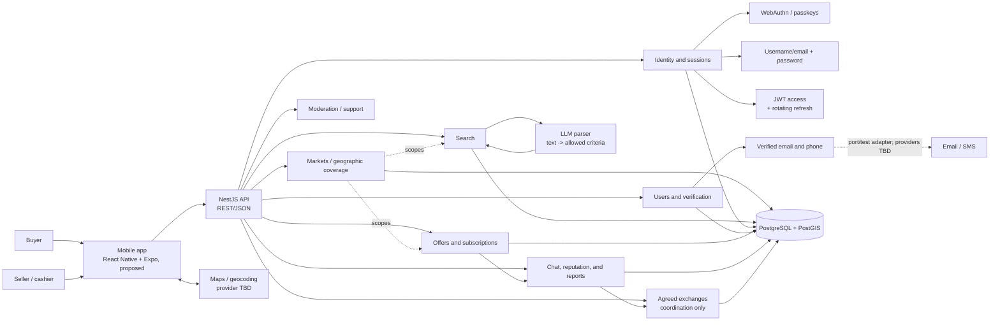

# Target architecture

This diagram describes the intended architecture; not all components are implemented. The MVP starts as a NestJS modular monolith with hexagonal boundaries. Avoid microservices until traffic or team boundaries justify them.

## Responsibility boundaries

- Nest controllers translate HTTP into use cases; they do not hold business rules or query SQL directly.
- Domain/application depend on ports; PostgreSQL, WebAuthn, email, SMS, LLM, and maps adapters live in infrastructure.
- A `Market` defines an active geographic service scope. It may correspond to a city for the MVP, but a market is not just a city-name string; its service area is represented geographically and queried with PostGIS.
- Every offer belongs to one market. Searches require an active market context and apply both that market scope and the geographic filters; a location hint parsed from text does not silently switch markets.
- Conversations and agreed exchange records inherit their market context from the originating offer. Create an exchange record only after both parties explicitly agree to the offer terms; it records coordination and does not settle or custody funds.
- User identity, credentials, and sessions are global. Selecting a market is separate from signing in and is not an authorization grant; the API validates permissions and resource-market consistency on every operation.
- PostgreSQL is the source of truth; PostGIS handles spatial queries. Versioned migrations are the only way to evolve a shared schema.
- The LLM parses natural language into allowed JSON criteria. The backend validates and runs parameterized queries; the model cannot access the database, generate SQL, calculate monetary values, or determine ranking.
- The marketplace coordinates contact and reputation but does not custody funds/crypto or settle exchanges.

## Current implementation status

The API in `apps/api` exposes `GET /health` and the initial authentication slice, backed by PostgreSQL identity/session tables and migrations. E2E coverage exercises password registration/login/recovery, sessions, private profile output, phone verification, and passkey challenge/error handling. Production email/SMS providers and native mobile passkey associations are not configured. The mobile client, market management/service-area persistence, offers, search, chat, subscriptions, and exchange records are not implemented yet. See the root `README.md` for product context and `docs/flows/` for intended user flows.
