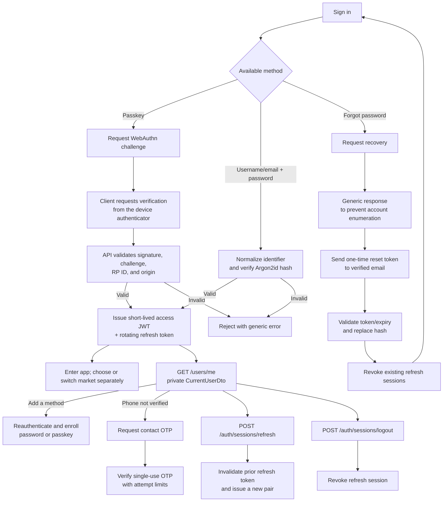

# Flow: MVP authentication

Approved MVP design: a user can sign in with either a passkey or username/email + password, and add the other method after authenticating. A verified phone number is a contact detail, not a sign-in factor. The API implements the initial authentication routes described here; production delivery providers and native mobile passkey associations remain pending.

## Intended contracts

- Password login accepts an `identifier` (normalized username or verified email) plus a password. Invalid, unknown, and disabled accounts receive indistinguishable errors.
- Email recovery is available only for a verified email. Reset tokens are random, short-lived, single-use, and stored safely; reset does not automatically sign in the user.
- Access JWTs are short-lived and carry minimal claims (`sub`, `iss`, `aud`, `iat`, `exp`, `jti`/`sid`) with no PII, password, or mutable roles. Store only a hash of opaque refresh tokens, rotate them on every use, and revoke the token family on replay.
- Accounts, credentials, and sessions are global, not city/market-specific. Users choose or switch the active market separately from authentication; an active-market value is request context, not proof of authorization. The API must validate access and resource-market consistency for each operation.
- SMS OTP is only for phone contact verification. Never log or store codes in plaintext; limit requests by phone/IP.
- A passkey-only user who loses every passkey goes through audited manual support recovery; do not trust SMS alone to take over an account.
- The future mobile client stores tokens using iOS Keychain/Android Keystore-backed storage, never AsyncStorage.

## Current implementation status

The API implements password registration with email verification, password login/recovery/reset, JWT access and rotating refresh sessions, the private `GET /users/me` DTO, phone OTP flows behind delivery ports, and WebAuthn registration/authentication handlers. Automated e2e tests use in-memory email/SMS adapters and cover successful password flows, refresh rotation/replay, challenge generation, malformed passkey responses, and private DTO fields. They do not yet verify a valid real authenticator assertion. No real email/SMS provider is configured, and real iOS/Android passkey sign-in remains blocked on production RP/domain association setup.

## Requirements for real mobile passkeys

The API needs a stable `WEBAUTHN_RP_ID` and an exact origin allowlist. The domain and iOS Bundle ID/Team ID plus Android application ID/signing certificate are not known yet. Production requires `apple-app-site-association` and `assetlinks.json` associations. `localhost` is for development only; real mobile passkey integration is blocked until these associations are configured.
