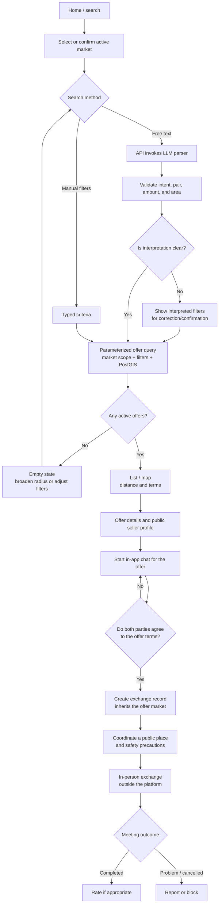

# Flow: search, contact, and meeting



## LLM search contract

Example interpretation of “needing 50 bucks on Intercomunal via USDT”:

```json
{
  "intent": "search_offer",
  "direction": { "give": "USDT", "receive": "USD_CASH" },
  "amount": { "value": 50, "asset": "USD_CASH" },
  "location": { "hint_text": "Intercomunal Avenue, Ciudad Ojeda", "radius_km": 5 }
}
```

The active market is selected by the user/app and validated by the backend; the LLM does not choose or change it. The backend validates fields/enums, resolves the area, confirms ambiguity, and ensures the area is within the selected market before building parameterized SQL scoped to that market and using PostGIS for proximity. If a location hint points to another market, ask the user to switch or clarify rather than silently searching there. Manual filters remain available if the parser fails. Do not send unnecessary PII to the LLM or execute SQL generated by the model.

## Safety and reputation

- Show approximate distances/meeting areas, never users' home addresses.
- Recommend public places and explain the service boundary: TUDOLAR connects people but does not guarantee cash/authenticity or custody the exchange.
- The exchange record represents mutual agreement and coordination only; it does not process or settle the exchange.
- Allow reports and blocking; use a moderation process for fraud or counterfeit-cash reports.
- Label paid promotion; do not present subscription priority as neutral recommendation.
