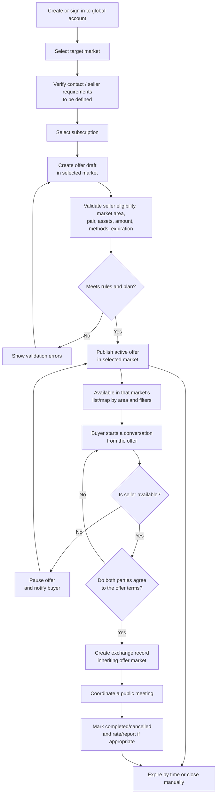

# Flow: seller and offer lifecycle

## Intended product rules

- Buyers do not pay a subscription or per-exchange commission.
- Sellers pay a fixed monthly plan; limits and priority are enforced by the backend and explained to users.
- Publish only offers that pass domain validation, plan limits, and applicable moderation in the selected market.
- Each offer belongs to exactly one market. Account identity is global; market selection does not create a separate account or itself grant seller permissions.
- The billing scope of seller plans and whether seller profiles are global or market-specific remain to be decided. Publication eligibility must still be checked for the selected market.
- Basic/Pro prices and benefits from the proposal are hypotheses to validate before committing.
- Profile verification, KYC, and badges must not promise that an in-person exchange is safe. Confirm regulatory requirements and support procedures before the pilot.
