# SP04 — Finalize the agreement, cancellation, and incident state machine

## 1. Task and acceptance criteria

Quoted from the backlog snapshot (`/tmp/backlog2.md`, lines 53–58):

> ### SP04 — Finalize the Agreement, Cancellation, and Incident State Machine
> **Suggested owner:** Product + marketplace backend + trust/safety. **Depends on:** T00; independent spike, parallelizable.
> - Specify the structured terms snapshot and version; bilateral confirmation as `confirmed_by_both`; reconfirmation after a terms change; and bilateral completion.
> - Define normal mutual cancellation, no unilateral cancel after confirmation, no-show/payment/safety incident reporting, and when a reservation is released after an incident.
> - Keep "confirmed," "completed," and "verified" distinct; the app does not escrow funds or compel an exchange.
>
> **Acceptance criteria:** a state diagram and transition table cover both parties, changed terms, mutual cancel, no-show, safety issues, completion disagreement, and inventory release; acceptance tests are specified for every transition.

The adjacent task that consumes this design is T13 (`/tmp/backlog2.md`, lines 199–206); its wording is the strongest constraint on the machine and is cited throughout. T09 (lines 175–180) owns the offer lifecycle and the reservation/availability arithmetic this machine drives.

## 2. Evidence and sources

### Observed (read in the repository)

- **No agreement/exchange code exists yet.** `README.md:55` and `docs/architecture.md:57` both state offers, search, chat, subscriptions, and **exchange records are not implemented**; `apps/api/prisma/schema.prisma` declares only identity models (`User`, `PasskeyCredential`, `AuthSession`, `AuthChallenge`, `EmailActionToken`, `PhoneVerificationChallenge`). This spike is therefore a greenfield design, not a change to existing behavior.
- **The product is coordination-only.** `AGENTS.md:11` — the app "does not custody cash/crypto, settle exchanges, or provide escrow"; `README.md:9` repeats it. `docs/architecture.md:49` — "Create an exchange record only after both parties explicitly agree to the offer terms; it records coordination and does not settle or custody funds." `docs/flows/search-and-contact.md:53` — the record "represents mutual agreement and coordination only."
- **The exchange record inherits market context.** `docs/architecture.md:49`, `AGENTS.md:9`, `README.md:27`, and `docs/flows/seller-offer-lifecycle.md:20` all require the record to inherit the originating offer's market.
- **Intended flow.** `docs/flows/search-and-contact.md:21–28`: *both parties agree → exchange record → coordinate meeting → in-person exchange outside the platform → outcome (completed → rate; problem/cancelled → report or block)*. `docs/flows/seller-offer-lifecycle.md:18–22`: *both agree → exchange record → coordinate → mark completed/cancelled and rate/report*.
- **T13 fixes the core invariants** (`/tmp/backlog2.md:199–206`): create the record only when **both confirm the same version**; `confirmed_by_both` "records mutual commitment; it does not verify that the exchange occurred or mean it is complete"; **freeze** the accepted version and require a **new version + reconfirmation** for any change; **atomically reserve only that transaction's amount**; allow other buyers while availability remains; **no unilateral cancellation through the normal flow**; cancellation after confirmation **only by mutual agreement**; return the reserved amount **only if the offer is still active and valid and the seller has not withdrawn it**; record **no-show / payment problem / safety concern as an incident** and let the person **withdraw without forcing the exchange**; mark **complete only after both confirm**, otherwise **record an incident**; the exchange happens directly between the parties, outside the platform.
- **Availability arithmetic** (T09, `/tmp/backlog2.md:178–180`): `availability = initial amount − reserved − completed`; reserve atomically on mutual confirmation; hide the offer at zero and let it **reappear if availability is released while it remains valid/active**. SP03 (lines 47–52) repeats the same model (immutable initial amount, whole transactions, mutual cancellation restores availability).
- **Terms-change protection** (SP02, `/tmp/backlog2.md:44–46`): material offer changes must be **versioned**, and "edits cannot silently change terms already confirmed by both parties."
- **Persistence conventions to reuse** (`apps/api/prisma/schema.prisma`): UUID PKs via `gen_random_uuid()`, `@db.Timestamptz(6)` timestamps, snake_case `@map` columns, a string `status`/`account_status` column, and a `Json` `context` column. `AGENTS.md:37` makes Prisma the sole migration authority; `AGENTS.md:45` requires `numeric`/integer minor units for money.
- **Test placement** (`docs/testing/e2e.md:56–73`): API scenarios go in `apps/api/test/<area>.e2e-spec.ts` and assert observable contract; `docs/testing/e2e.md:90–96` names what a handoff must carry. `openspec/config.yaml:42–48` requires observable WHEN/THEN specs and names the hexagonal layer for each unit.
- **Terminology discipline** (SP04 AC, line 57): "confirmed," "completed," and "verified" must stay distinct.

### Assumed (not verifiable from the repository — flagged for the product owner)

- The **transition set below is a proposal**, not an existing rule. T13 fixes several transitions explicitly (reservation on confirmation, mutual-cancel release, no normal unilateral cancel, incident recording), but **which additional transitions the product wants is the product owner's call** and is marked unresolved in §5.
- **Who may initiate** an agreement (buyer vs seller vs either), and whether a chat conversation must precede it, are not stated in any source I read; both are treated as open.
- The **release semantics after a single-party incident report** are genuinely ambiguous: T13 says the amount returns to availability "after mutual cancellation," and separately that an incident may be reported and the person may "withdraw" — it does not say whether withdrawal alone releases the reservation. I do not invent that; it is §5's headline decision.
- I did not inspect `openspec/changes/archive/**` beyond the e2e foundation spec, and no prior SP01–SP03 report exists yet under `docs/spikes/` to reconcile against.

## 3. Options considered

### 3.1 Entity name

- **`Agreement`** — matches this spike's title and the "agreed exchange record" phrasing. **Kept** as the working name (the code module may still be called `exchanges`).
- **`Exchange` / `ExchangeRecord`** — matches T13's title and the existing `Exchanges` node in `docs/architecture.md:17`. Equivalent; naming is a PO call (§5).
- **`Transaction`** — rejected: the backlog uses "transaction" for the reserved/whole unit of an offer (T09), so reusing it for the agreement record would collide.

### 3.2 When the record is created

- **On the first party's acceptance** of a frozen terms version (record exists in `awaiting_confirmation`). **Recommended** — it lets the UI show "waiting for the other party," stores the exact snapshot, and makes reconfirmation a transition on the same row.
- **Only on the second confirmation** (T13's literal "create the record when buyer and seller confirm"). Simpler to write, but then partial-confirmation state must live somewhere else (chat), and reconfirmation after a terms change is awkward. Rejected as the primary model, but noted: T13's wording supports it and the PO may prefer it.

### 3.3 Representing confirmation

- **Two nullable timestamps (`buyer_confirmed_at`, `seller_confirmed_at`) + a derived `status`.** **Recommended** — makes "same version" checkable (compare each timestamp's version), gives auditability, and avoids a third state source. `confirmed_by_both` is derived when both are set for the current version.
- **A separate `agreement_confirmation` row per party per version.** More general (supports >2 parties, richer audit) but heavier; **rejected** for a two-party MVP while noting it as the natural evolution if a third role appears.
- **A single `status` enum only, no per-party columns.** Rejected — it cannot express *who* confirmed *which* version, which T13 requires.

### 3.4 Terms snapshot and versioning

- **Immutable `agreement_terms_version` rows** (monotonic `version` int, `snapshot` as structured columns plus a `Json` payload, `created_at`, `created_by`). **Recommended** — matches SP02's "material changes are versioned" and T13's "freeze the accepted version," and lets an agreement reference the exact version each party confirmed.
- **A single `Json` snapshot column on the agreement, overwritten on change.** Rejected — overwriting destroys the audit trail and lets a change silently alter confirmed terms (forbidden by SP02).
- **Snapshot only the offer's fields at confirmation time.** Kept as a refinement: the snapshot should capture **pair, amount, rate, seller margin/commission, and agreed conditions** (T13 line 201) — the exact field list is SP02's, not this spike's.

> **Correction — `docs/adr/0001-terms-versions-belong-to-the-offer.md` (spike-interface-reconciliation).**
> The immutable terms version belongs to the **OFFER**, not the agreement. This report's
> agreement-scoped `agreement_terms_version` is superseded: the source of truth is the offer's
> `offer_terms_versions` (the design SP09 recommends), and the agreement references an offer version id
> rather than owning the snapshot. A denormalized copy of the referenced version on the agreement is
> allowed, but it is not the source. The original recommendation above is left visible as evidence.

### 3.5 Reconfirmation after a terms change

- **Same agreement returns to `awaiting_confirmation` with version N+1; both confirmations reset.** **Recommended** — one record, clear audit chain.
- **A new agreement is created and the old one is cancelled.** Cleaner separation, but splits the history and forces the reservation to move between rows. Rejected unless the PO prefers immutable one-shot records.
- **Reservation handling during reconfirmation** (keep held vs release immediately) is **not decided here** — it is the same family of decision as §5's incident release. Both are surfaced.

### 3.6 Incident model

- **A separate `incident` entity** with `type ∈ {no_show, payment_problem, safety, counterfeit, other}`, reporter, subject, description, and a lifecycle `status ∈ {open, under_review, resolved, dismissed}`. **Recommended** — one agreement can accumulate several incidents, and SP07 (lines 71–75) owns report/moderation/appeal workflows; keeping incidents separate lets trust & safety evolve without touching the agreement table.
- **A single `incident_type` column on the agreement.** Rejected — cannot hold multiple incidents or a moderation lifecycle.

### 3.7 Reservation release on incident

- **(A) Release only on mutual cancellation or a moderation decision.** The reservation stays held while an incident is open. Safe against a party unilaterally freeing inventory by filing an incident, but can pin inventory indefinitely on a genuine no-show.
- **(B) A single party's incident report releases the reservation** (with anti-abuse limits). Frees inventory fast, but hands one party a unilateral escape hatch that T13's "no unilateral cancellation through the normal flow" seems designed to prevent.
- **(C) Incident opens a `disputed` state; release happens only via mutual cancel, moderation, or a time-based expiry.** A middle path.
  **Unresolved — product owner with trust & safety input (§5, U1).** This is the single most consequential choice in the machine; the transition table below marks the release edge as conditional on it.

### 3.8 Cancellation shape

- **Two-step mutual cancellation** (`request` then `accept`). **Recommended** — matches "only by mutual agreement," is idempotent, and handles the case where both press cancel at once. It also gives the offer an obvious point to restore availability.
- **Single-step: cancel only if both parties submit cancel in the same window.** Rejected — racy and harder to audit.

### 3.9 Completion shape

- **Bilateral completion**: each party records "the exchange happened"; `completed` only when both have. **Recommended and required** by T13 ("complete only after both confirm").
- **One party marks complete, the other gets a dispute window.** Rejected as the primary model (T13 is explicit), but the dispute window is effectively what the incident path provides.

### 3.10 Agreement expiry / staleness

- **No expiry** — an agreement waits indefinitely. Simple, but pinned inventory if the other party never acts.
- **Time-based expiry** returning an unconfirmed agreement (and releasing its reservation) after a window. Plausible and aligns with the offer's own expiry (T09), but **no source sets the window** — **unresolved (§5, U3).**

## 4. Recommendation

Adopt a **two-party agreement record** with an **immutable versioned terms snapshot**, **per-party confirmation timestamps**, a **derived `confirmed_by_both` status**, **bilateral completion**, **two-step mutual cancellation**, and a **separate incident entity**. Reserve the amount **atomically** at `confirmed_by_both`, and release it to offer availability on mutual cancellation (or per §5 U1). Treat incidents as recorded, retained, and moderation-driven; never let them silently mark a completion.

### 4.1 States (proposed)

| State | Meaning | Reservation |
| --- | --- | --- |
| `awaiting_confirmation` | A frozen terms version exists; at least one party has not confirmed it. | none held |
| `confirmed_by_both` | Both parties confirmed the **same** version. | amount reserved atomically |
| `completed` | Both parties reported the exchange happened. | reservation → completed |
| `cancelled` | Both parties agreed to cancel (mutual). | released to availability* |
| `incident_open` | An incident (no-show / payment / safety / completion disagreement) is recorded and unresolved. | held or released — §5 U1 |
| `expired` *(optional)* | An unconfirmed agreement passed its window. | released — §5 U3 |

\* released only if the offer is still active and valid and the seller has not withdrawn it (T13).

### 4.2 State diagram (proposed)

```mermaid
stateDiagram-v2
    [*] --> awaiting_confirmation: propose terms (freeze snapshot v1)
    awaiting_confirmation --> awaiting_confirmation: one party confirms (partial)
    awaiting_confirmation --> confirmed_by_both: second party confirms same version\n(atomically reserve amount)
    confirmed_by_both --> awaiting_confirmation: terms changed -> new version vN+1\n(both confirmations reset; reservation handling OPEN)
    confirmed_by_both --> completed: both parties confirm exchange happened
    confirmed_by_both --> cancelled: both agree to cancel (mutual)
    awaiting_confirmation --> cancelled: both agree to cancel (no reservation held)
    confirmed_by_both --> incident_open: report no-show / payment / safety
    awaiting_confirmation --> incident_open: report no-show / payment / safety
    incident_open --> cancelled: parties agree to cancel
    incident_open --> completed: both confirm it completed (not disputed)
    incident_open --> incident_open: counterparty contests (completion disagreement)
    incident_open --> cancelled: moderation resolves (release reservation*)
    awaiting_confirmation --> expired: window elapses (OPEN)
    completed --> [*]
    cancelled --> [*]
    expired --> [*]
```

**Forbidden transition:** there is **no edge from `confirmed_by_both` to `cancelled` driven by one party** — T13 forbids unilateral cancellation through the normal flow. The only escapes after confirmation are mutual cancellation, an incident/moderation path, or (if adopted) expiry.

**`*` note:** the incident→cancelled release edge is conditional on §5 U1. If option (A) is chosen, release happens only after mutual cancellation or moderation, and the reservation stays held while the incident is open.

### 4.3 Transition table (proposed)

| # | From | Event | Actor | Guard / precondition | To | Side effects |
| --- | --- | --- | --- | --- | --- | --- |
| T1 | — | propose terms | either party | offer active/valid; parties eligible; snapshot valid | `awaiting_confirmation` | create agreement; freeze snapshot v1; set initiator confirmation; no reservation |
| T2 | `awaiting_confirmation` | confirm (first) | the non-initiator | version matches current snapshot | `awaiting_confirmation` | set that party's `confirmed_at` (+ version) |
| T3 | `awaiting_confirmation` | confirm (second) | remaining party | both confirm **same** version; `availability ≥ amount` | `confirmed_by_both` | **atomically** reserve amount; `availability −= amount`; hide offer if 0 |
| T4 | `confirmed_by_both` | terms changed | either party / seller edit | new terms differ; version frozen (SP02) | `awaiting_confirmation` | create snapshot vN+1; reset both confirmations; reservation handling **OPEN** (§5 U2) |
| T5 | `awaiting_confirmation` | reconfirm (both) | both parties | both confirm vN+1; `availability ≥ amount` | `confirmed_by_both` | reserve/re-reserve atomically |
| T6 | `confirmed_by_both` | complete (first) | a party | — | `confirmed_by_both` | record first completion claim |
| T7 | `confirmed_by_both` | complete (second) | the other party | both claim completion | `completed` | reservation → completed; `completed += amount` |
| T8 | `confirmed_by_both` | dispute completion | the disagreeing party | — | `incident_open` | create incident `completion_disagreement`; do **not** mark completed |
| T9 | `awaiting_confirmation` \| `confirmed_by_both` | request mutual cancel | a party | — | same state + `cancel_requested_by` | record request |
| T10 | (cancel requested) | accept mutual cancel | the other party | offer still active/valid, not withdrawn (for release) | `cancelled` | release reservation → `availability += amount`; offer may reappear if it was hidden at 0 |
| T11 | `awaiting_confirmation` \| `confirmed_by_both` | report incident | a party | type ∈ {no_show, payment_problem, safety, counterfeit, other} | `incident_open` | create incident; retain record; party may withdraw |
| T12 | `incident_open` | withdraw | reporting party | — | `incident_open` | record withdrawal; **reservation release = §5 U1** |
| T13 | `incident_open` | resolve | moderation / support (or mutual) | outcome decided | `completed` \| `cancelled` | apply outcome; release or complete reservation per resolution |
| T14 | `awaiting_confirmation` | expire | system | window elapsed | `expired` | release any held reservation — **§5 U3** |
| T15 | `confirmed_by_both` | **unilateral cancel** | one party | — | — | **REJECTED — no such transition** (T13) |

### 4.4 "Confirmed" vs "completed" vs "verified"

| Term | What it means | Source |
| --- | --- | --- |
| **confirmed** (`confirmed_by_both`) | Both parties committed to the **same frozen terms version**. | T13 line 201 |
| **completed** | Both parties **reported** the in-person exchange happened. | T13 line 205 |
| **verified** | The platform independently confirmed funds/assets moved. **Not offered.** | `AGENTS.md:11`, `README.md:9`, `docs/architecture.md:53` |

A `completed` agreement is **never** labelled "verified"; the platform has no custody, escrow, or settlement and cannot attest that the exchange occurred. (Identity/contact *verification* — verified email/phone — is a separate, unrelated axis and must not be conflated with exchange completion.)

## 5. Unresolved decisions

| ID | Decision | Owner | Why it is open |
| --- | --- | --- | --- |
| **U1** | **Does a single-party incident report release the reservation, or only mutual cancellation / moderation?** Options A/B/C in §3.7. | Product owner + trust & safety | T13 releases on *mutual cancellation* and separately allows an incident report + withdrawal; it never says withdrawal alone releases. Highest-impact choice in the machine. |
| **U2** | **During reconfirmation (T4), is the reservation held or released?** | Product owner + backend | Prevents double-hold vs pinning inventory; no source states it. |
| **U3** | **Do unconfirmed agreements expire, and after what window?** | Product owner | Keeps inventory from being pinned by an unresponsive party; no window is defined anywhere. |
| **U4** | **Entity name and module**: `Agreement` vs `Exchange`/`ExchangeRecord`; marketplace module vs a dedicated one. | Product owner + architect (T02) | This spike's title vs the existing `Exchanges` node in `docs/architecture.md:17`. |
| **U5** | **Who may initiate an agreement** (buyer, seller, or either), and must a chat conversation precede it? | Product owner | `docs/flows/*.md` imply a chat-then-agree flow but do not require it. |
| **U6** | **Exact snapshot field list** (pair, amount, rate, seller margin/commission, agreed conditions, meeting place?). | Product owner + SP02 | T13 names pair/amount/rate/conditions; the authoritative list is SP02's. |
| **U7** | **Incident evidence, severity, SLA, and appeal** for no-show / payment / safety. | Trust & safety (SP07) | SP07 owns report/moderation/appeal workflows. |
| **U8** | **Whether incidents are visible to the counterparty** and what the counterparty sees. | Product owner + trust & safety | Privacy boundary not defined; `docs/flows/search-and-contact.md:49–54` only covers meeting areas. |
| **U9** | **Which statuses feed the seller's daily summary** (completed only? cancelled? incidents?). | Product owner + SP11 | SP11 lines 92–98 own status inclusion and the profit-vs-volume distinction. |

## 6. Product and technical impact

**Product.** Buyers and sellers gain an explicit, auditable commitment: a frozen terms version both accept, a clear "waiting for the other party" state, a mutual-cancel path, and a recorded incident path that lets a person walk away without the app forcing an exchange. The design keeps the app's promise — it coordinates, it does not escrow, settle, or guarantee safety (`AGENTS.md:11`, `README.md:9`). Choosing U1/U2/U3 changes how quickly inventory returns to the market and how exposed a party is to a bad-faith counterparty, so these are supply- and trust-shaping decisions, not just plumbing.

**Technical.** New persistence (names per U4): `agreement`, `agreement_terms_version` (immutable snapshots), per-party confirmation columns, `agreement_event` (audit), and `incident`. Reservation stays owned by the offer (T09/SP03): `availability = initial − reserved − completed`, mutated **atomically** inside the confirming transaction (`AGENTS.md:41` — keep atomicity, never read-then-write; `AGENTS.md:46` — one atomic business operation per transaction). Money in the snapshot uses `numeric`/minor units (`AGENTS.md:45`). The confirming transition (T3) must be a compare-and-swap so concurrent confirmations cannot over-reserve (T09 line 180; SP03 lines 47–52). Per `AGENTS.md:54–70` and `openspec/config.yaml:15–19`, the state machine lives in the marketplace module's `domain/`, transitions are driven by use cases in `application/`, HTTP controllers stay thin in `adapters/in/`, and trust & safety owns the incident lifecycle behind a port. Prisma remains the sole migration authority (`AGENTS.md:37`). Mobile (T19, lines 240–245) consumes the statuses via RTK Query and must never present `completed` as `verified`.

## 7. Testable scenarios

WHEN/THEN, in the `docs/testing/e2e.md` / `openspec/config.yaml:42–43` style. Each transition T1–T14 needs at least one; the forbidden T15 needs a negative test.

1. **Create (T1).** WHEN one party proposes terms for an active offer THEN an agreement exists in `awaiting_confirmation`, the snapshot is frozen at version 1, and no amount is reserved.
2. **Partial confirmation (T2).** WHEN the first party confirms THEN the agreement stays `awaiting_confirmation` and no reservation is made.
3. **Bilateral confirmation (T3).** WHEN the second party confirms the **same** version THEN status becomes `confirmed_by_both` AND the agreed amount is reserved AND `availability = initial − reserved − completed`.
4. **Version mismatch is refused.** WHEN the second party confirms a version that is not the current snapshot THEN the confirmation is rejected and no reservation is made.
5. **Concurrent reservations do not over-reserve.** WHEN two buyers confirm against an offer with availability for only one THEN exactly one reservation succeeds and availability never goes negative.
6. **Offer hides at zero.** WHEN a confirmation reserves the last available amount THEN the offer is no longer returned by search.
7. **Terms change resets confirmation (T4).** WHEN the terms change after `confirmed_by_both` THEN a new version is created, both confirmations reset, and the previously confirmed terms are unchanged in history.
8. **Reconfirmation (T5).** WHEN both parties confirm the new version THEN status returns to `confirmed_by_both` and the reservation matches the new amount.
9. **Bilateral completion (T6/T7).** WHEN both parties confirm the exchange happened THEN status becomes `completed` AND the reservation moves from `reserved` to `completed`.
10. **Completion disagreement (T8).** WHEN one party disputes completion THEN an incident is recorded and the agreement is **not** marked `completed`.
11. **Mutual cancellation (T9/T10).** WHEN one party requests and the other accepts cancellation THEN status becomes `cancelled` AND the reserved amount returns to availability AND the offer reappears if it had been hidden at zero.
12. **No unilateral cancel (T15).** WHEN a single confirmed party attempts to cancel without the counterparty's agreement THEN the transition is rejected and the agreement stays `confirmed_by_both`.
13. **No-show incident (T11).** WHEN a party reports a no-show THEN an incident of type `no_show` is recorded, the agreement retains its history, and the reservation follows the U1 decision.
14. **Safety incident (T11).** WHEN a party reports a safety concern THEN a `safety` incident is recorded AND the reporting party can withdraw without the exchange being forced.
15. **Release after incident (T12/T13).** WHEN the incident is resolved by moderation THEN the reservation is released or the agreement completed according to the recorded outcome.
16. **Terminology.** WHEN an agreement is `completed` THEN the API/UI never labels it `verified` and never claims the exchange was settled or escrowed.

## 8. Sources reviewed

- `/tmp/backlog2.md` — SP04 (53–58), T01 (110–116), T09 (175–180), T13 (199–206), T14 (207–212), T19 (240–245), SP02 (42–46), SP03 (47–52), SP07 (71–75), SP11 (92–98).
- `AGENTS.md` — product context (5–15), spec-driven rules (17–31), PostgreSQL/PostGIS invariants (33–52), NestJS hexagonal layers (54–78).
- `README.md` — product/purpose (1–16), market scope (25–27), implementation status (49–55).
- `docs/architecture.md` — responsibility boundaries (43–53), implementation status (55–57).
- `docs/flows/search-and-contact.md` (1–55) and `docs/flows/seller-offer-lifecycle.md` (1–36).
- `docs/testing/e2e.md` — entry points, isolation, adding a scenario (56–73), handoff (90–96).
- `docs/audit/t00-baseline.md` — baseline revision and test set (1–16, 459–499).
- `openspec/config.yaml` — context and rules (3–63).
- `openspec/specs/testing/e2e-foundation/spec.md` — spec format reference.
- `apps/api/prisma/schema.prisma` — model/id/timestamp/status conventions.
